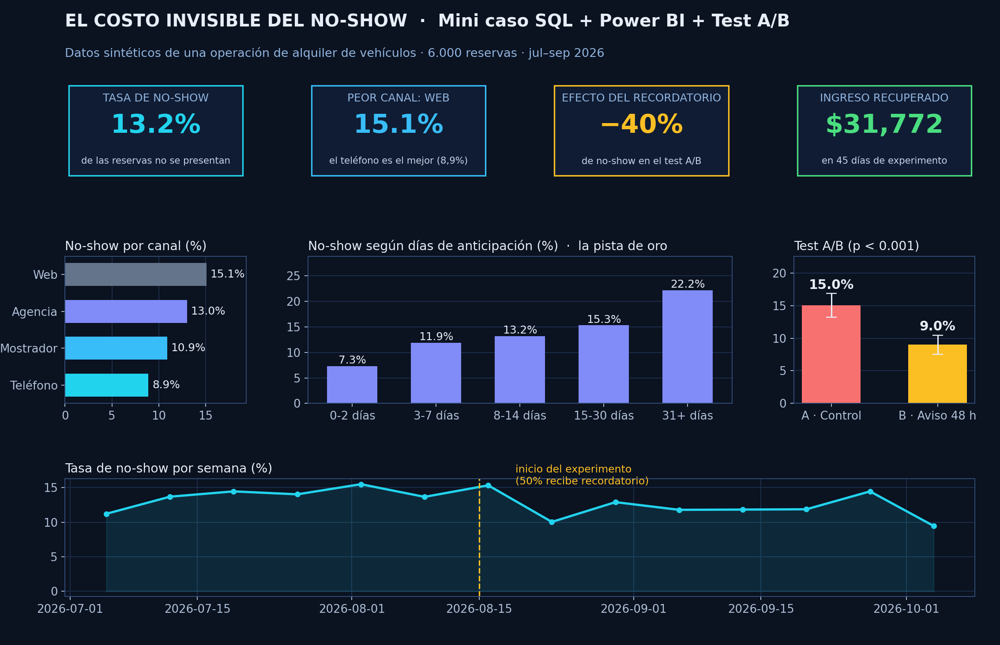

# El costo invisible del no-show 🚗💨

### Un mini caso con SQL, visualización y un test A/B — contado como me pasó a mí

## Primero, la historia

Trabajo con datos en una empresa de alquiler de vehículos, y hay un problema que todos conocen pero nadie había medido: el **no-show**. El cliente reserva, el carro queda apartado… y nunca aparece. El carro no se renta, el ingreso no entra, y al final del mes nadie sabe cuánto se perdió.

Un día me pregunté: **¿y si lo medimos de verdad?** Este mini caso es eso: agarré el problema, lo rompí en preguntas, lo ataqué con SQL y terminé probando una solución con un experimento A/B. Sin humo, con números.

> 📌 **Transparencia total:** los datos de este repositorio son **100% sintéticos** (generados por mí, con la misma estructura del problema real). Nunca publicaría datos de clientes. Las cifras son de juguete; el proceso, no: es exactamente el que uso en mi trabajo.

## Lo que hice, paso a paso

**1. Armé los datos.** Generé 6.000 reservas (canal, tipo de vehículo, días de anticipación, tarifa, si el cliente es frecuente y si se presentó o no). El script está en [`analisis.py`](analisis.py) y cualquiera puede reproducirlo: usa semilla fija, así que da los mismos números siempre.

**2. Pregunté con SQL.** Las consultas están en [`sql/consultas.sql`](sql/consultas.sql). Lo primero fue lo básico: ¿qué tan grande es el problema? Después, ¿dónde se concentra?

Lo que encontré:

- **13,2% de las reservas no se presentan.** Casi 1 de cada 7. Ahí había plata.
- **El canal Web es el peor (15,1%)** y el teléfono el mejor (8,9%). Reservar en línea sale fácil… y olvidar también.
- **La anticipación es la pista de oro:** quien reserva de 0–2 días antes casi siempre llega (7,3% de no-show). Quien reserva con 31+ días de anticipación **no llega el 22,2% de las veces**. La gente no es mala: reserva con emoción, y un mes después la vida cambió.
- El tipo de vehículo no importaba. El problema era de comportamiento, no de producto.

**3. Probé la solución con un test A/B.** Mi hipótesis era simple: *si le recordamos al cliente 48 horas antes, llega más gente*. Durante 45 días, la mitad de las reservas recibió recordatorio y la otra mitad no (asignación al azar, como debe ser):

| Grupo | Reservas | No-show |
|---|---|---|
| A — Sin recordatorio | 1.482 | **15,0%** |
| B — Con recordatorio 48 h | 1.498 | **9,0%** |

## El resultado (esto es lo que importa)

El recordatorio bajó el no-show de **15,0% a 9,0%**: son **6 puntos porcentuales menos**, una reducción del **40%**. Y no es suerte: el intervalo de confianza (95%) va de −8,4 a −3,7 puntos y el valor p es menor a 0,001. En plata: unas **90 reservas recuperadas en 45 días ≈ $31.800** con el ticket promedio del caso. Si ese efecto se mantuviera todo el año, hablamos de **~$250.000**.

¿La lección? A veces la solución no es un modelo de machine learning de 3 meses. Es medir bien, encontrar el patrón… y **mandar un recordatorio**.

## Lo que haría después

Un modelo simple que le ponga una etiqueta de riesgo a cada reserva (Web + mucha anticipación = riesgo alto) y le dedique el doble aviso solo a esas. Mismo principio: datos primero, esfuerzo donde más duele.

## Herramientas que usé

SQL (SQLite) · Python (pandas y matplotlib para generar los datos, la estadística y la visual) · Visual estilo Power BI · Test A/B con prueba z de proporciones

---

*Soy José Andrés Sequeira Hernández, analista de datos en Costa Rica (Python · SQL · Power BI · Tableau). Este es un mini caso de portafolio: proceso completo, de la pregunta al resultado.*
